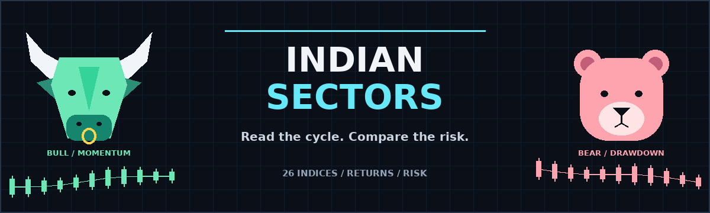

  

<strong>Read the cycle. Compare the risk.</strong> 
Learn sector rotation through Indian market returns, comparisons, and risk analysis.

  <a href="https://indianindices.github.io/">Open dashboard</a> &middot;
  <a href="https://indianindices.github.io/#compare">Compare Sectors</a> &middot;
  <a href="https://indianindices.github.io/#summary">Market Overview</a> &middot;
  <a href="CONTRIBUTING.md">Contribute</a>

**26 Indian indices. Returns, comparisons and investment calculators.**
Explore sectoral, market-cap and thematic indices without an account or installation.

- Monthly, quarterly and annual returns, heatmaps and CAGR rankings.
- Sector comparisons, growth, excess returns, drawdown and recovery.
- SIP, LumpSum and SWP calculators with graphs and CSV/PNG exports.

## Documentation

See [docs/METHOD.md](docs/METHOD.md) for methodology, calculations, configuration,
data refresh, deployment and local development. Read [CONTRIBUTING.md](CONTRIBUTING.md)
before proposing changes, or report issues through [GitHub Issues](https://github.com/indianindices/indianindices.github.io/issues).

## License

Original project code, documentation and artwork use **PolyForm Noncommercial 1.0.0**.
Noncommercial use, modification and redistribution are permitted under its terms.
Commercial uses outside its permitted purposes require separate permission.
This is source-available, not OSI-approved open source. See [LICENSE](LICENSE)
and preserve the attribution in [NOTICE](NOTICE).

Third-party dependencies retain their own licenses. The bundled financial and
statistics libraries and their MIT/ISC notices are documented in [vendor/README.md](vendor/README.md).
Market data is subject to its source's terms; this project does not grant rights to it.

**Past performance does not predict future returns. This project is not investment advice.**

## Support IndianIndices

If you find IndianIndices useful, you can [contribute](CONTRIBUTING.md) or
use the dashboard's [support](https://indianindices.github.io/#support) button for UPI payments from India or PayPal
internationally. You can also support the project through the repository's
**Sponsor** button. Your support
helps cover hosting, data, development and future improvements.
