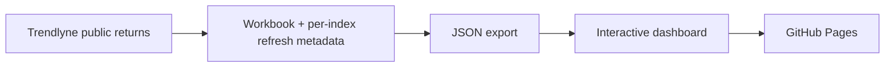

# Methodology and Development Process

Detailed dashboard behavior, calculations, data refresh, configuration, deployment
and local development. For the project overview, see [README](../README.md).

## Dashboard

### Compare Sectors

The first navigation button opens the comparison workspace. Nifty50 and Next50
are selected initially; Nifty50 has a dashed line. Select individual indices
with checkboxes, or use **All / None**. Subtle button colours identify each metric.

**From / To** selects calendar years. The range is shared with asset pages,
but does not filter Market Overview. **Copy link** preserves the metric, selected indices
and years in the URL, including after reload. If clipboard access is unavailable,
a selectable link field appears instead.

### Individual indices

Search the sidebar or select an index to open its page. Each page includes:

- Monthly, quarterly and annual return histograms, with current-year annual values labelled **YTD**.
- YTD, previous-year return, 3Y / 5Y / 10Y CAGR, best/worst year, up-year frequency and annual volatility.
- A colour-graded returns table with **Monthly / Quarterly** buttons and a **3Y / 5Y / 10Y CAGR** selector.
- Year-range filters and CSV download.

Missing or unfinished values remain blank. Stat tiles retain their full-history
definitions when the chart/table range changes. The fixed five-year average row
is shown only when the full year range is selected.

### Market Overview

Market Overview has three tabs: **Annual heatmap** (the default), **Annual returns**
(the all-index chart), and **CAGR** (index rankings and the historical performance
write-up). The heatmap also offers monthly and quarterly modes with
a year selector. Switch tabs with a click or the Left/Right arrow keys.

- Rankings cover YTD, previous-year return, CAGR, volatility and up-year frequency.
- Click a column header to sort; click again to reverse direction. Missing values stay last.
- Returns default to highest first, volatility to lowest first. Index names open their pages.
- Hover the chart to rank legend entries for that year; hover an entry to highlight its line.
- Click legend entries to show/hide lines, or use **All / None**.
- Click an index in the heatmap to open its asset page.

Market Overview always uses all available data. The heuristic commentary is based on
past observations, **not a forecast**.

### UI configuration

Edit [ui-config.js](../frontend/ui-config.js) to choose which views appear. Use boolean
`true` / `false` values, then reload the preview or deploy the updated site.

```js
sections: {
  assets: true,
  compare: true,
  marketOverview: true,
  calculator: true,
  research: false,
}
```

Research is **off by default**. Set `sections.research` to `true` to show it;
use `subsections.research.quality`, `.screener`, or `.portfolio` to select its tabs.
The other subsection keys are:

- `marketOverview`: `heatmap`, `returns`, `cagr`.
- `calculator`: `sip`, `lumpsum`, `swp`.
- `compare`: `returns`, `growth`, `excess`, `rolling3`, `rolling5`, `drawdown`, `recovery`.
- `assets`: `stats`, `chart`, `returnsTable`.

The `features` object provides independent `calculatorSharing`, `savedScenarios`
and `watchlists` switches. All default to `true`; setting a feature to `false`
hides its controls without deleting previously saved browser data. Section and
subsection switches continue to take precedence for navigation.

A disabled parent hides all its children. A view with every child disabled is
also hidden. Tabs and keyboard navigation skip disabled children; disabled URLs
fall back to an enabled view or tab. If every view is off, an empty state appears
instead of redirecting repeatedly. Existing `#summary` links remain supported.

These are **UI visibility switches, not access control**: public scripts and data
are still deployed, and data fetching continues. Do not use them to protect
private or paid content. [dev.sh](../dev.sh) and Pages deployment both stage the config;
the already-running preview serves its staged copy, so rerun `./dev.sh` after changes.

### Calculator

**Calculator** sits below Market Overview in the sidebar. It has **SIP**,
**LumpSum**, and **SWP** tabs, enabled by default through `sections.calculator`
and `subsections.calculator`. Direct links use `#calculator/sip`,
`#calculator/lumpsum`, or `#calculator/swp`; disabled tabs follow the same fallback
and keyboard rules as the other views.

- SIP: monthly contribution, annual increase and month-start/month-end timing.
- LumpSum: one initial investment compounded over the selected duration.
- SWP: an initial corpus with month-end withdrawals and optional annual increases.
  Withdrawals cannot exceed the available corpus; depletion and unmet requested
  withdrawals are reported instead of allowing a negative balance.

Each tab has a live graph, projected values, a yearly breakdown, CSV cash flows
and PNG export. Assumptions are preserved separately when switching calculators.
The annual-return input is **effective annual**, converted to an equivalent monthly
rate; it is not divided by 12. Annual increases apply after each 12 projection
months, not at calendar New Year. Inputs support 1–50 years and assumed returns
from -50% to 50%, including zero and negative-return stress scenarios.

These are hypothetical constant-return projections, not forecasts based on index
history. Fees, taxes and inflation are excluded. Core future-value calculations
use the bundled MIT-licensed [financial 0.2.4](https://github.com/lmammino/financial)
library; no npm installation is needed to run the site.

### Personal Watchlists and Saved Scenarios

Sidebar star buttons pin indices locally. **All indices / Watchlist** switches
the sidebar scope, and search applies inside either scope. Pinned indices sort
first; starring an index does not change the current chart. **Saved comparisons**
on Compare stores up to 10 named combinations of metric, indices and year range.
Load a saved comparison through its link, or remove it with its remove button.

**Copy scenario link** captures the current calculator's mode, investment,
effective annual return, duration, start month, contribution timing and applicable
annual increase/withdrawal. The versioned `#calculator/...` URL fragment restores
those inputs and the same projection after reload. Invalid or unsupported links
leave current inputs unchanged and show a status message. If clipboard access
fails, a read-only selectable link is provided. The link shares the current
scenario only, not locally saved comparisons. The values are readable to anyone
with the URL; they are not encrypted. URL fragments are not sent in the initial
HTTP request, but should not be treated as a place for secrets.

Each calculator mode can save up to three named scenarios. Selected saved rows
overlay their balance curves on the live graph and appear side-by-side in the
comparison table. Load restores a scenario; remove deletes it. Comparisons use
actual scenario calendar dates, so different start dates shift their curves.
PNG legends/captions include selected scenarios and assumptions. CSV adds their
monthly balances and settings to the current projection's timeline; values are
blank outside the saved scenario's available dates.

Watchlists, comparisons and saved scenarios use versioned browser local storage,
not the waitlist backend. Reload restores valid records; malformed or unknown
records are ignored. Clearing site storage removes them, and they do not sync
across devices. If storage is blocked or full, changes remain usable for the
session and the status explicitly says **this session only**. Anyone sharing the
same browser profile can access this local data.

### Historical Backtest

The independently enabled **Backtest** view (`sections.backtest`, default `true`;
`subsections.backtest.historical`) uses completed monthly Trendlyne returns, not
the Calculator's assumed constant rate. Select SIP or lump sum, exact start/end
months, investment amount, non-negative index weights totaling 100%, annual SIP
step-up (0-50%), contribution timing and purchase costs (0-500 bps). Additional
indices start at zero weight; Equal weights distributes across checked indices.
The allocation editor is always visible. Equal weights and Nifty50 only sit
above the index list; Nifty50 only resets allocation to the benchmark.
The colored bar shows positive weights and the total flags allocations that do
not sum to 100%. Hovering or keyboard-focusing a segment highlights it and opens
a floating tooltip with the index name and allocation; Escape dismisses it.
3Y / 5Y / 10Y / All presets use the available Nifty50 history; selected indices
must still cover that exact period. Annual SIP increases use a numeric field.
Result animation respects reduced-motion settings.
Every positively weighted index and Nifty50 must have each selected month;
missing or ambiguous history causes an error, never zero-filling or shortening.

Month-start contributions receive that month's return; month-end contributions
receive returns from the following month. Lump sums always invest at the start.
Annual SIP increases apply after each 12 contributions. Each deposit purchases
the target weights after deducting costs; existing holdings drift, without
rebalancing. The benchmark receives identical cash flows and purchase costs.
Fractional holdings and immediate execution at monthly boundaries are assumed.

SIP XIRR uses negative dated deposits and a positive terminal value, actual days
divided by 365, solved by bisection in log-rate space. Month-start cash flows are
dated the first calendar day; month-end and terminal values use the last calendar
day. Annualized values over short periods can be extreme; zero-length or
uncomputable XIRRs stay blank. Lump-sum CAGR uses the same elapsed-day basis and
requires at least one year. Total-loss terminal values report -100% XIRR when
elapsed time is positive. Max drawdown uses a unitized, cash-flow-neutral net
performance series including purchase costs, not the growing cash balance.
After a total loss its drawdown stays at -100%, even if new money is deposited.

CSV includes monthly transactions and captured settings, allocations, data source,
export date and return basis. PNG captures the visible chart and assumptions.
Versioned `#backtest?...` links restore valid settings; invalid or unavailable
history leaves current inputs unchanged. Sharing exposes the inputs in the URL.
This is a monthly approximation from rounded returns, not a date-specific trade
backtest or an investable fund result. Return basis remains unverified; dividends
are not added. Taxes, inflation, tracking differences and final liquidation are
excluded. Existing monthly refresh scheduling is unchanged.

### Research

When enabled in the config, the **Research** entry opens three views, with independent monthly date controls:

- **Data quality:** first/last valid monthly observations, interior missing months,
  invalid or duplicate observations, independent monthly/quarterly refresh status,
  and monthly-to-quarterly reconciliation. Three complete months are compounded;
  discrepancies above **0.10 percentage points** are flagged without changing data.
- **Benchmark screener:** 12-, 36- or 60-month rolling returns against Nifty50,
  strict outperformance frequency, average/latest excess in percentage points,
  matched-window counts and month-end drawdown with its coverage. Filter by minimum
  windows, win rate or current outperformance, and choose the ranking metric.
- **Diversification:** non-negative weights totaling 100%, initial investment,
  buy-and-hold or calendar-month/quarter/year rebalancing, and trading costs in bps.
  The chart compares the hypothetical portfolio with Nifty50 buy-and-hold. A
  correlation matrix uses the same shared monthly sample for every selected pair.

All research views export CSV. Portfolio PNG/CSV exports include allocation and
cost settings. Research links such as `#research/screener` open the requested view;
the previous `#summary` link remains valid for Market Overview.

**Limits:** the source's price-return versus total-return designation is not
independently verified and is labeled **unverified**, not assumed to be TRI.
Dividends are not added separately. Screener dates select rolling-window endpoints;
lookback months may precede the selected start date. Windows overlap and are not
independent forecasts. Simulation and correlations use the latest uninterrupted
shared history within the selected dates, never filling gaps with zero. Correlations
and annualized monthly volatility require 24 observations; portfolio CAGR requires
12 months. Constant-series correlations stay blank. Simulation excludes taxes,
fund tracking differences, cash flows and final liquidation costs.

## Comparison modes

| Mode | What it measures | Important detail |
|---|---|---|
| Annual returns | Each calendar year's index return | Current year is YTD, not a completed year. |
| Growth of ₹10,000 | Completed quarterly returns compounded from a shared starting balance | Uses the latest uninterrupted history common to all selected indices. Changing the selection/range rebases every line. |
| Excess vs Nifty50 | Index annual return minus Nifty50's same-year return | **Percentage points**, not relative percentage gain: 20% minus 15% is +5 pp. Missing benchmark values remain blank. |
| 3Y / 5Y rolling CAGR | Annualized returns at each quarter-end using 12 or 20 consecutive quarters | Year filters select endpoints, not the preceding lookback. A missing quarter leaves a blank. |
| Drawdown | Decline from the running peak since the common starting date | Quarter-end observations only; daily or within-quarter losses may be worse. |
| Recovery (quarters) | Elapsed quarters below the previous peak, resetting to zero when it is regained | Risk tables include maximum/current drawdown, longest underwater duration, worst trough and worst-episode recovery, or **Not recovered**. |

The displayed common period defines growth, drawdown and recovery comparisons.
Risk modes use straight lines; other comparison curves are visual interpolation,
not extra market observations. Growth is hypothetical index performance without
fees, taxes or additional cash flows; dividends are not added separately.

## Chart controls and exports

The **+**, **−** and **fit-view** icons sit **inside the top-right of each graph**, beside the price axis.
Hover them for tooltips. PNG export and All/None remain outside the plot.

| Action | Control |
|---|---|
| Zoom | In-graph + / − icons, mouse wheel, or `+` / `-` keys |
| Pan | Click and drag the plot |
| Stretch | Drag the price or time axis |
| Fit | In-graph fit-view icon, double-click the plot, or `F` |
| Export data | **Download CSV** on asset and comparison pages |
| Export image | **PNG** on asset, Market Overview, comparison and portfolio charts |

CSV files respect the selected indices, metric and year range; missing values
are empty. Asset CSV files use the returns table's monthly or quarterly mode.
Growth files include the starting balance and quarter-end values in INR.
PNG files capture the **visible chart viewport**, not off-screen periods. They
include titles, period context, export date, source and visible-series legends.
Market Overview exports exclude hidden lines; empty comparison charts cannot export a PNG.

Direct links work for [Market Overview](https://indianindices.github.io/#summary),
[Compare](https://indianindices.github.io/#compare) and individual indices such as
[PSUBanks](https://indianindices.github.io/#asset/PSUBanks). Use **Copy link** for a
configured comparison. The top-right GitHub icon returns to this repository.

## Data and year rollover

Returns come from [Trendlyne](https://trendlyne.com/). A GitHub Actions workflow
is scheduled for the **3rd of every month**, and also runs on pushes to `main`
or through **Actions > Refresh data and deploy > Run workflow**.

The workflow fetches returns, exports website data, commits workbook changes
when returns or refresh metadata change, and deploys GitHub Pages.

Monthly and quarterly histories come from the same source response. Both use the
existing workbook in `backend/data/sectoraldata.xlsx`: monthly returns are stored in the hidden `_MonthlyReturns`
sheet, with independent `_MonthlyRefreshStatus` metadata. No second Excel file
is needed. The workbook provides a saved fallback when the source is unavailable;
the browser reads only the JSON export. Unfinished months and quarters are blank.
Run `./dev.sh --refresh` once to populate monthly history in an older workbook.
Raw Excel and CSV files live in `backend/data/`; the generated `backend/data/sectoraldata.csv`
remains ignored by Git. The public JSON is generated at `frontend/data.json`
and published at the site root; neither raw file is included in deployment.

### What happens next year?

**Year labels advance automatically after a new export and deployment.**
The export uses its actual calendar year, rather than a hard-coded year.
When the source supplies a new-year row, it appears as that year's **YTD**.
The outgoing year becomes a completed-year row or heatmap column, and ranking/stat
labels move to the new current year and previous year. Year selectors expand to
include the supplied years. This applies to each future year without annual code changes.

This is **not a midnight update** in an already-open browser. It requires a
new export/deployment and a page reload. Missing source years are not invented;
an index without a new-year source row has no new-year return yet. Completed
previous-year results also depend on the source having supplied the final values.
A saved comparison with explicit end dates intentionally keeps that range until changed.

## Methodology

| Metric | Definition |
|---|---|
| Monthly / quarterly / annual return | Reported by the source; the current year's annual value is YTD. Only completed months and quarters are shown. |
| Stat-tile CAGR | Last 4 × N consecutive available quarterly returns, compounded and annualized. |
| Historical table CAGR | N consecutive calendar-year annual returns ending in the row year. |
| Current-year table CAGR | Trailing quarters through the latest available completed quarter. |
| Annual volatility | Sample standard deviation of completed calendar-year returns. |
| Up years | Share of completed years with strictly positive annual returns. |
| Market Overview risk-adjusted score | Mean annual return divided by annual volatility; **not a Sharpe ratio**. |

Source rounding, available history and missing observations limit precision.
The dashboard footer links to the [Data & methodology page](https://indianindices.github.io/methodology.html), which explains the calculations and assumptions.

## How it works

The repository separates the static browser application in `frontend/` from
the offline data pipeline and Supabase schema in `backend/`. This is not a
new API server: backtesting still runs in the browser against the JSON export.
`frontend/assets/` contains public icons/payment images, `frontend/vendor/`
contains runtime libraries and licenses, and each side has its own tests.
Root files are limited to project documentation, licenses and the dev launcher.
The private root `.env` is read by the configuration generator, never staged.



| File | Responsibility |
|---|---|
| [build_sectoraldata.py](../backend/build_sectoraldata.py) | Fetches monthly and quarterly returns together, preserves cached data on failure, and writes workbook calculations and independent refresh metadata. |
| [export_data.py](../backend/export_data.py) | Exports JSON with the current calendar year, hides unfinished months and quarters, and rejects indices without usable quarterly history. |
| [index.html](../frontend/index.html) | Sidebar and asset, comparison, Market Overview and Research views. |
| [ui-config.js](../frontend/ui-config.js) | Top-level view and subsection visibility switches; Research defaults off. |
| [app.js](../frontend/app.js) | Navigation, charts, calculations, rankings, sharing, CSV and PNG exports. |
| [analytics.js](../frontend/analytics.js) | Pure monthly reconciliation, benchmark, correlation and portfolio calculations. |
| [research.js](../frontend/research.js) | Research controls, tables, portfolio chart and exports. |
| [backtest.js](../frontend/backtest.js) | Historical backtest controls, allocation tooltips, results and exports. |
| [generate-config.mjs](../backend/scripts/generate-config.mjs) | Validates public Supabase settings and writes browser-safe configuration. |
| [setup.sql](../backend/supabase/setup.sql) | Waitlist permissions, write-only RPCs and private signup metrics. |
| [tests/analytics.test.cjs](../frontend/tests/analytics.test.cjs) | Known-result research tests, including gaps, sample limits and fee accounting. |
| [style.css](../frontend/style.css) | Responsive layout and visual theme. |
| [dev.sh](../dev.sh) | Exports local data and serves the dashboard. |
| [.github/workflows/update-data.yml](../.github/workflows/update-data.yml) | Scheduled refresh and Pages deployment. |

Charts use [TradingView Lightweight Charts](https://github.com/tradingview/lightweight-charts).
The in-graph and export icons are bundled [Lucide](https://lucide.dev/) assets.
Research statistics use bundled [simple-statistics 7.8.8](https://github.com/simple-statistics/simple-statistics),
with its ISC license preserved under [vendor/simple-statistics.LICENSE](../frontend/vendor/simple-statistics.LICENSE).

## Local setup

Use Python with the project requirements (CI uses Python 3.12) and Node.js 22+
for public configuration generation and JavaScript tests. No npm install is required.
Run the following commands from the repository root.

```bash
python3 -m venv .venv
source .venv/bin/activate
python -m pip install -r backend/requirements.txt
./dev.sh
```

Open http://localhost:8000. Stop the server with Ctrl+C.
If that port is occupied, stop the existing preview or run `PORT=9000 ./dev.sh`.
Use `./dev.sh --refresh` only when you want to fetch live source data and rewrite
the workbook; ordinary startup exports the existing workbook without fetching.

### Checks

```bash
node --test frontend/tests/*.test.cjs
python3 -m unittest discover -s backend/tests -p 'test_*.py'
git diff --check
```

Tests cover return calculations, comparison modes, rankings, export metadata,
share links, refresh fallbacks, year rollover, waitlist requests and safe public
configuration generation. Python tests use mocked requests
and temporary workbooks; they do not fetch live data or modify the real workbook.

### Recreating the artwork

The banner is original artwork, not an illustration of actual index prices.
Its generator requires optional Pillow and a TrueType font; neither is needed
to run the dashboard. The default font path is DejaVu Sans Bold on Linux.

```bash
python -m pip install Pillow
python3 docs/make_banner.py
convert docs/brand.gif -layers Optimize docs/brand.gif
```

Use `--font /path/to/font.ttf` for a different font location. The generator
produces an optional animated banner and the static [header artwork](brand.png)
used in the repository README.

## Publication and Dependencies

Original project materials are source-available under the PolyForm Noncommercial
1.0.0 [LICENSE](../LICENSE). Noncommercial use, changes and redistribution are
permitted subject to its terms, including preserving [NOTICE](../NOTICE).
This is not OSI-approved open source. Uses outside the license's permitted
purposes require separate permission. Contributors retain copyright; obtain
appropriate rights before offering commercial editions containing their work.
Public repositories and browser-delivered JavaScript, CSS, HTML and JSON remain
inspectable. Keep future proprietary backend logic and private data outside
public deployment artifacts. UI switches are visibility controls, not access control.

The detailed process in this file is repository documentation, not included in
the Pages staging allowlist. It is still publicly readable if the repository
is public. Check GitHub plan and Pages eligibility before making the repo private.

The bundled [financial](../frontend/vendor/financial.min.js) and
[simple-statistics](../frontend/vendor/simple-statistics.min.js) scripts are required by
calculators, Research and their Node tests. Their respective MIT and ISC notices must remain
with the distributions. [vendor/README.md](../frontend/vendor/README.md) explains provenance;
it is documentation rather than executable code. Charts load Lightweight Charts
from its pinned CDN URL, and the toolbar uses Lucide assets. Those dependencies
retain their own rights; the project license does not relicense them or market data.